<!-- synced-from: README.md sha256:89744ace434222709035f8ca5fefded916447ecc9b779282fa61bdeeea609be2 -->

# archify-graft-rs — Reference & Operations Manual (CHM Guide)

<p align="center">
  <a href="README.md">🇹🇷 Türkçe</a> | <a href="README.en.md">🇬🇧 English</a>
</p>

<p align="center">
  <a href="#what-it-does"><strong>📖 Docs</strong></a> • <a href="LICENSE"><strong>⚖️ License</strong></a>
</p>

> **Archify-Graft:** a pure-Rust engine that indexes a codebase, searches it in three languages (TR/AR/EN), and compiles neon architecture diagrams from the call graph. No Node.js, no Bun, no V8, no Python; one binary, one source of truth.

---

## 📑 Index & Navigation

<details open>
<summary><strong>[Expand / Collapse the tree index]</strong></summary>

- [What it does](#what-it-does)
  - [Tabbed capability channels](#tabbed-capability-channels)
- [Architecture](#architecture)
  - [Vector architecture map](#vector-architecture-map)
  - [Dataflow map](#dataflow-map)
  - [Workspace crates (25 packages)](#workspace-crates-25-packages)
- [Installation](#installation)
- [Usage examples](#usage-examples)
- [Dependencies](#dependencies)
- [What's New](#whats-new)
- [Cross References](#cross-references)

</details>

---

## What it does

Archify-Graft fuses **Graft**'s deterministic AST code graph and personalized PageRank (GraphRank) search with **Archify**'s JSON-IR architecture modelling and signature neon visual language in a single engine. Everything is compiled in native Rust; at runtime it starts no external interpreter, virtual machine, or package manager.

| Parameter (Stat) | Value | Operational role |
|---|---|---|
| **System type** | Rust workspace (25 packages) | 24 micro-crates + root `archify-graft-cli` binary |
| **Version** | 0.1.0 | Declared in `[workspace.package]` |
| **License** | MIT | Open-source distribution model |
| **Input languages** | Rust, JS/TS, Python, Go, Java, C/C++ | Body-scanned symbol and call-edge extraction |
| **Interface languages** | Turkish, Arabic, English | Tokenization, normalization, diagram localization |
| **Persistence** | rkyv 0.8 + memory-mapped binary | Zero-copy reads, incremental FNV-1a index |
| **Agent interface** | MCP (JSON-RPC, stdio) | 10 tools: `graft_index`, `graft_ask`, `graft_hedef`, … |

### Tabbed capability channels

<details open>
<summary><strong>1.1 Code intelligence and search (graft)</strong></summary>

- **Incremental index:** each file's content is hashed with FNV-1a; an unchanged file is never re-parsed.
- **Trilingual tokenization:** Arabic diacritics (tashkeel) and elif variants are folded; Turkish `ı/i` and `İ/I` mapping is preserved; English camelCase/snake_case is split into sub-words.
- **Ranking:** BM25 lexical score and personalized GraphRank propagation are scored together; hits are grouped into declarations and file bodies.

</details>

<details>
<summary><strong>1.2 Visualization and layout (archify)</strong></summary>

- **5 diagram types:** Architecture, Sequence, Dataflow, Lifecycle, Workflow.
- **Layout:** standalone Sugiyama layered placement; orthogonal edge routing, A* grid finder, edge bundling.
- **Output:** self-contained SVG and HTML; RTL layout for Arabic, a legend for deltas.
- **Delta engine:** computes added, removed, and changed nodes/edges between two diagrams.

</details>

<details>
<summary><strong>1.3 Hardware layer and persistence</strong></summary>

- **Direct I/O:** `FILE_FLAG_NO_BUFFERING` on Windows and `O_DIRECT` on Linux, with sector-aligned (4096-byte) reads; the OS page cache is bypassed.
- **Hardware probing:** cache-line detection, core affinity, and a TSC-based cycle counter.
- **Zero-copy:** a pinned wire contract via `rkyv 0.8`; the graph is read in place from a memory-mapped file.

</details>

<details>
<summary><strong>1.4 The aim layer: <code>hedef</code></strong></summary>

Turns a repository's own claim into machine-readable form. Source precedence:

1. `.harness/hedefler.json` — the shared `archify-hedef/1` schema (see `docs/HEDEF_SEMASI.md`).
2. If absent, `.harness/feature-list.json` — the legacy schema, **marked** as `kaynak: "cevirici"` in the output.
3. If neither exists, the board comes back empty; no goal is invented.

An unrecognized status word, an unknown schema tag, or a row without a status is reported as **okunamadı** (unreadable) and never rounded up to green. `--ozet` prints counts only, `--json` prints the full record.

</details>

---

## Architecture

The diagrams below were compiled from this repository's own call graph by the `archify-graft` DMA AST extractor. Source: `index .` → 8 files scanned, **1276 nodes and 2147 edges**.

### Vector architecture map

<p align="center">
  
</p>

- 🔍 **[Interactive architecture viewer (pan & zoom HTML)](docs/archify-graft-rs_arch.html)**: live component and link map.
- 🖼️ **[Vector architecture map (SVG)](docs/archify-graft-rs_arch.svg)**: high-resolution vector map.

### Dataflow map

<p align="center">
  
</p>

- 🔍 **[Interactive dataflow viewer (HTML)](docs/archify-graft-rs_dataflow.html)**: live pan/zoom view of the pipeline.
- 🖼️ **[Vector dataflow map (SVG)](docs/archify-graft-rs_dataflow.svg)**: vector diagram.

### Workspace crates (25 packages)

<details open>
<summary><strong>Hardware and core model</strong></summary>

- `lowlevel-sys`: direct DMA I/O, cache-line detection, core affinity, TSC counter.
- `graft-model`: `NodeV1`, `EdgeV1`, `CodeGraph` models; rkyv zero-copy serialization and varint framing.
- `graft-i18n`: trilingual tokenizer and normalizer.

</details>

<details>
<summary><strong>Code analysis and extraction</strong></summary>

- `graft-cargo`: Cargo workspace manifest parser and path-dependency resolver.
- `graft-rust`: pure Rust scanner; comment/string masking and call extraction.
- `graft-langs`: JS/TS, Python, Go, Java, C/C++ item and call extractors.
- `graft-langs-link`: cross-language import and call linking.
- `graft-parser`: Rayon-based parallel scanner, incremental FNV-1a hash index.
- `graft-search`: memory-mapped BM25 index and personalized GraphRank.

</details>

<details>
<summary><strong>Archify visualization and layout</strong></summary>

- `archify-ir`: strict JSON-IR schemas for 5 diagram types, delta models, and story beats.
- `archify-geometry`: BFS reachability and topological A* shortest path.
- `archify-style`: preset palettes (Editorial, Neon, Classic), themes, stroke styles.
- `archify-route`: orthogonal edge routing, A* grid finder, bundling, lane pushing.
- `archify-layout`: standalone Sugiyama layered placement.
- `archify-motion`: animation curves, camera pan/zoom interpolation, tour steps.
- `archify-scene`: scene node generation, layered structure compilation, tour ordering.
- `archify-crates`: crate dependency hierarchy inference and role labelling.
- `archify-bridge`: compiles Architecture, Sequence, and Dataflow diagrams from the AST.
- `archify-render`: neon SVG/HTML export, Arabic RTL, delta legend.
- `archify-delta`: add/remove/change diff engine.
- `archify-hedef`: aim layer — `.harness/hedefler.json` (shared schema) or the marked legacy converter.

</details>

<details>
<summary><strong>Desktop UI and integration</strong></summary>

- `archify-egui-paint`: multi-pass neon bloom painter and link arcs.
- `archify-egui`: `egui` + `wgpu` desktop studio, canvas management, search layer.
- `graft-mcp`: asynchronous MCP JSON-RPC server for agents.
- `archify-graft-cli`: root command-line interface that drives every pipeline.

</details>

---

## Installation

<details open>
<summary><strong>Tab A: Build the binary from source (recommended)</strong></summary>

```sh
git clone https://github.com/Ercaner1988/archify-graft-rs.git
cd archify-graft-rs
cargo build --release --locked
# Binary: target/release/archify-graft-cli.exe (Windows) / archify-graft-cli (Linux, macOS)
```

This workspace is not published to crates.io, so `cargo install --path .` also works; `cargo add` would be misleading.

</details>

<details>
<summary><strong>Tab B: GPU studio (egui + wgpu)</strong></summary>

```sh
cargo build --release --locked --features gui
```

The `gui` feature enables the `archify-egui` crate and the `wgpu` backend (DirectX 12 / Vulkan / Metal). The default build keeps the UI out of the binary.

</details>

<details>
<summary><strong>Tab C: Wiring it as an MCP server</strong></summary>

```sh
archify-graft-cli mcp
```

The server speaks JSON-RPC over stdio. Configuration example:

```json
{
  "mcpServers": {
    "archify-graft": {
      "command": "archify-graft-cli",
      "args": ["mcp"]
    }
  }
}
```

</details>

<details>
<summary><strong>Tab D: Tests and the quality gate</strong></summary>

```sh
cargo test --workspace --locked -j 2
cargo fmt --all --check
cargo clippy --workspace --all-targets --locked -j 2 -- -D warnings
kapi . --guvenilen-kod
```

Last measurement (2026-11-03): **58 test binaries, 254 passed, 0 failed**; `fmt` and `clippy` clean; `kapi` **9 green · 0 red**.

</details>

---

## Usage examples

| Command | Syntax example | Description |
|---|---|---|
| `index` | `archify-graft-cli index .` | Indexes the codebase with an incremental DMA scan, writes `.cache/graft-graph.bin` |
| `ask` | `archify-graft-cli ask "direct DMA"` | TR/AR/EN BM25 + GraphRank search |
| `grep` | `archify-graft-cli grep 'fn main'` | Regex search over the index; hits grouped as declaration/body |
| `skeleton` | `archify-graft-cli skeleton src/main.rs` | Shows signatures only, for one file |
| `map` | `archify-graft-cli map .` | Budgeted repo orientation: directory clusters, hubs, hotspots |
| `diagram` | `archify-graft-cli diagram -t architecture --output arch.svg` | Emits an Architecture/Sequence/Dataflow/Delta diagram |
| `check` | `archify-graft-cli check` | Fails if the index is stale relative to the code (CI) |
| `watch` | `archify-graft-cli watch .` | Watches changes and re-indexes incrementally |
| `hedef` | `archify-graft-cli hedef . --ozet` | The repository's aim board: counts only |
| `gui` | `archify-graft-cli gui` | Interactive studio, if built with `--features gui` |
| `mcp` | `archify-graft-cli mcp` | MCP server for agents (stdio) |

```sh
# Typical end-to-end flow
archify-graft-cli index .
archify-graft-cli map . --max-dirs 30
archify-graft-cli diagram -t architecture --output docs/architecture.svg --title "System Architecture" --locale en
archify-graft-cli hedef . --ozet
```

---

## Dependencies

<!-- kapi-belge:bagimliliklar:start -->
| Dependency | Declared version |
|---|---|
| `serde` | `{ version = "1.0", features = ["derive"] }` |
| `serde_json` | `1.0` |
| `rkyv` | `0.8` |
| `rayon` | `1.10` |
| `tokio` | `{ version = "1.40", features = ["full"] }` |
| `memmap2` | `0.9` |
| `petgraph` | `0.6` |
| `thiserror` | `1.0` |
| `anyhow` | `1.0` |
| `log` | `0.4` |
| `env_logger` | `0.11` |
| `clap` | `{ version = "4.5", features = ["derive"] }` |
| `unicode-normalization` | `0.1` |
| `regex` | `1.10` |
| `eframe` | `{ version = "0.37.0", default-features = false, features = ["default_fonts"] }` |
| `egui` | `{ version = "0.37.0", features = ["monochrome_emoji_fonts"] }` |
| `lowlevel-sys` | `{ path = "crates/lowlevel-sys" }` |
| `graft-model` | `{ path = "crates/graft-model" }` |
| `graft-i18n` | `{ path = "crates/graft-i18n" }` |
| `graft-parser` | `{ path = "crates/graft-parser" }` |
| `graft-search` | `{ path = "crates/graft-search" }` |
| `archify-ir` | `{ path = "crates/archify-ir" }` |
| `archify-geometry` | `{ path = "crates/archify-geometry" }` |
| `archify-bridge` | `{ path = "crates/archify-bridge" }` |
| `archify-render` | `{ path = "crates/archify-render" }` |
| `archify-delta` | `{ path = "crates/archify-delta" }` |
| `archify-hedef` | `{ path = "crates/archify-hedef" }` |
| `archify-egui` | `{ path = "crates/archify-egui", optional = true }` |
| `graft-mcp` | `{ path = "crates/graft-mcp" }` |
<!-- kapi-belge:bagimliliklar:end -->

---

## What's New

- **Aim layer (`archify-hedef/1`):** repository boards became machine-readable under a shared schema; when a legacy `feature-list.json` is present the converter takes over and the output says so.
- **`hedef` command and the `graft_hedef` MCP tool:** the board is readable both from the CLI (`--ozet` / `--json`) and through an agent.
- **Documentation alignment:** README crate counts matched to the 25 workspace packages; `powershell` fences became `bash`.
- Detailed release history: this repository has no `CHANGELOG.md` yet; release notes live in commit messages. The board's current state is read with `hedef . --ozet`.

---

## Cross References

- **[Aim schema](docs/HEDEF_SEMASI.md)**: `archify-hedef/1` fields, status words, and the unreadable rule.
- **[Aim layer](docs/AMAC_KATMANI.md)**: why the board exists and how to read it.
- **[Aim migration instructions](docs/HEDEF_GECIS_TALIMATI.md)**: moving from the legacy schema to the shared one (11 repositories).
- **[Vision](docs/VIZYON.md)**: the engine's scope and limits.
- **[Quality gate configuration](kapi.toml)**: `kapi` dimensions and thresholds.
- **[License](LICENSE)**: MIT.
