# archify-graft-rs — Başvuru ve İşletim El Kitabı (CHM Kılavuzu)

<p align="center">
  <a href="README.md">🇹🇷 Türkçe</a>
</p>

<p align="center">
  <a href="#ne-işe-yarar"><strong>📖 Belgeler</strong></a> • <a href="LICENSE"><strong>⚖️ Lisans</strong></a>
</p>

> **Archify-Graft:** Kod tabanını indeksleyen, üç dilli (TR/AR/EN) arama yapan ve çağrı grafiğinden neon mimari şemalar üreten saf Rust motoru. Node.js, Bun, V8 ve Python yoktur; tek ikili, tek doğruluk kaynağı.

---

## 📑 İçindekiler ve Sekmeli Dizin (Index & Navigation)

<details open>
<summary><strong>[Ağaç Dizinini Daralt / Genişlet]</strong></summary>

- [Ne işe yarar](#ne-işe-yarar)
  - [Sekmeli Yetenek Kanalları](#sekmeli-yetenek-kanalları)
- [Mimari](#mimari)
  - [Vektörel Mimari Şeması](#vektörel-mimari-şeması)
  - [Veri Akışı Şeması](#veri-akışı-şeması)
  - [Çalışma Alanı Dermeleri (25 Paket)](#çalışma-alanı-dermeleri-25-paket)
- [Kurulum](#kurulum)
- [Örnek kullanım](#örnek-kullanım)
- [Bağımlılıklar](#bağımlılıklar)
- [Yenilikler](#yenilikler)
- [Çapraz Başvurular ve İlgili Belgeler](#çapraz-başvurular-ve-ilgili-belgeler)

</details>

---

## Ne işe yarar

Archify-Graft; **Graft**'ın deterministik AST kod grafını ve kişiselleştirilmiş PageRank (GraphRank) aramasını, **Archify**'ın JSON-IR mimari modellemesi ve imza niteliğindeki neon görselleştirmesiyle tek motorda birleştirir. Yazılım tamamıyla yerel Rust ile derlenir; çalışma zamanında harici yorumlayıcı, sanal makine ya da paket yöneticisi çağırmaz.

| Parametre (Stat) | Değer | İşletimsel Rol |
|---|---|---|
| **Sistem Tipi** | Rust çalışma alanı (25 paket) | 24 mikro-derme + kök `archify-graft-cli` ikilisi |
| **Sürüm** | 0.1.0 | `[workspace.package]` beyanı |
| **Lisans** | MIT | Açık kaynak dağıtım modeli |
| **Girdi Dilleri** | Rust, JS/TS, Python, Go, Java, C/C++ | Gövde taramalı sembol ve çağrı kenarı çıkarımı |
| **Arayüz Dilleri** | Türkçe, Arapça, İngilizce | Belirteçleme, normalizasyon, diyagram yerelleştirmesi |
| **Kalıcılık** | rkyv 0.8 + bellek haritalı ikili | Sıfır-kopya okuma, artımlı FNV-1a indeks |
| **Ajan Arayüzü** | MCP (JSON-RPC, stdio) | 10 araç: `graft_index`, `graft_ask`, `graft_hedef`, … |

### Sekmeli Yetenek Kanalları

<details open>
<summary><strong>1.1 Kod Zekası ve Arama (graft)</strong></summary>

- **Artımlı indeks:** Dosya içeriğinin FNV-1a karması tutulur; değişmeyen dosya yeniden ayrıştırılmaz.
- **Üç dilli belirteçleme:** Arapça harekeler (tashkeel) ve elif varyantları sadeleştirilir; Türkçe `ı/i` ve `İ/I` eşlemesi korunur; İngilizce camelCase/snake_case alt sözcüklere ayrılır.
- **Sıralama:** BM25 sözcüksel skoru ile kişiselleştirilmiş GraphRank yayılımı birlikte puanlanır; sonuç bildirim (declaration) ve dosya gövdesi olarak ikiye ayrılır.

</details>

<details>
<summary><strong>1.2 Görselleştirme ve Yerleşim (archify)</strong></summary>

- **5 diyagram türü:** Mimari, Sıralama, Veri Akışı, Yaşam Döngüsü, İş Akışı.
- **Yerleşim:** Bağımsız Sugiyama katmanlı kutu yerleştirme; dik açılı kenar yönlendirme, A* ızgara bulucu, kenar demetleme.
- **Çıktı:** Kendi kendine yeten SVG ve HTML; Arapça için RTL yerleşim, delta için lejant.
- **Delta motoru:** İki diyagram arasındaki eklenen, silinen ve değişen düğüm/kenarları hesaplar.

</details>

<details>
<summary><strong>1.3 Donanım Katmanı ve Kalıcılık</strong></summary>

- **Doğrudan G/Ç:** Windows'ta `FILE_FLAG_NO_BUFFERING`, Linux'ta `O_DIRECT` ile sektör hizalı (4096 bayt) okuma; işletim sistemi sayfa önbelleği atlanır.
- **Donanım ölçümü:** Önbellek satırı tespiti, çekirdek ilgisi ve TSC tabanlı döngü sayacı.
- **Sıfır-kopya:** `rkyv 0.8` ile sabitlenmiş tel sözleşmesi (wire contract); graf bellek haritalı dosyadan yerinde okunur.

</details>

<details>
<summary><strong>1.4 Amaç Katmanı: <code>hedef</code></strong></summary>

Deponun kendi iddiasını makine okunur hâle getirir. Kaynak önceliği:

1. `.harness/hedefler.json` — ortak `archify-hedef/1` şeması (bkz. `docs/HEDEF_SEMASI.md`).
2. Yoksa `.harness/feature-list.json` — eski şema, çıktıda `kaynak: "cevirici"` diye **işaretlenir**.
3. İkisi de yoksa tahta boş döner; uydurma hedef üretilmez.

Tanınmayan durum sözcüğü, bilinmeyen şema etiketi ya da durumsuz satır **okunamadı** sayılır ve yeşile yuvarlanmaz. `--ozet` yalnız sayım verir, `--json` tam kaydı verir.

</details>

---

## Mimari

Aşağıdaki şemalar bu deponun kendi çağrı grafiğinden, `archify-graft` DMA AST çıkarıcısıyla derlenmiştir. Kaynak: `index .` → 8 dosya tarandı, **1276 düğüm ve 2147 kenar**.

### Vektörel Mimari Şeması

<p align="center">
  
</p>

- 🔍 **[İnteraktif Mimari Görüntüleyici (Pan & Zoom HTML)](docs/archify-graft-rs_arch.html)**: Canlı bileşen ve bağlantı haritası.
- 🖼️ **[Vektörel Mimari Şeması (SVG)](docs/archify-graft-rs_arch.svg)**: Yüksek çözünürlüklü vektör haritası.

### Veri Akışı Şeması

<p align="center">
  
</p>

- 🔍 **[İnteraktif Veri Akışı Görüntüleyici (HTML)](docs/archify-graft-rs_dataflow.html)**: Boru hattının canlı pan/zoom şeması.
- 🖼️ **[Vektörel Veri Akış Şeması (SVG)](docs/archify-graft-rs_dataflow.svg)**: Vektörel diyagram.

### Çalışma Alanı Dermeleri (25 Paket)

<details open>
<summary><strong>Donanım ve Çekirdek Model</strong></summary>

- `lowlevel-sys`: Doğrudan DMA G/Ç, önbellek satırı tespiti, çekirdek ilgisi, TSC sayacı.
- `graft-model`: `NodeV1`, `EdgeV1`, `CodeGraph` modelleri; rkyv sıfır-kopya serileştirme ve varint çerçeveleme.
- `graft-i18n`: Üç dilli belirteçleyici ve normalleştirici.

</details>

<details>
<summary><strong>Kod Analizi ve Çıkarım</strong></summary>

- `graft-cargo`: Cargo çalışma alanı bildirimi ayrıştırıcısı ve yol bağımlılığı çözümleyicisi.
- `graft-rust`: Saf Rust tarayıcı; yorum/dizge maskeleme ve çağrı çıkarımı.
- `graft-langs`: JS/TS, Python, Go, Java, C/C++ öğe ve çağrı çıkarıcıları.
- `graft-langs-link`: Diller arası içe aktarma ve çağrı bağlama.
- `graft-parser`: Rayon tabanlı paralel tarayıcı, artımlı FNV-1a hash indeksi.
- `graft-search`: Bellek haritalı BM25 indeksi ve kişiselleştirilmiş GraphRank.

</details>

<details>
<summary><strong>Archify Görselleştirme ve Yerleşim</strong></summary>

- `archify-ir`: 5 diyagram türü, delta modelleri ve hikâye adımları için katı JSON-IR şemaları.
- `archify-geometry`: BFS erişilebilirliği ve topolojik A* en kısa rota.
- `archify-style`: Önayar paletler (Editorial, Neon, Classic), temalar, vuruş biçimleri.
- `archify-route`: Dik açılı kenar yönlendirme, A* ızgara bulucu, demetleme, şerit itme.
- `archify-layout`: Bağımsız Sugiyama katmanlı yerleştirme.
- `archify-motion`: Animasyon eğrileri, kamera pan/zoom enterpolasyonu, tur adımları.
- `archify-scene`: Sahne düğümü üretimi, katmanlı yapı derleme, tur sıralama.
- `archify-crates`: Derme bağımlılık hiyerarşisi çıkarımı ve rol etiketleme.
- `archify-bridge`: AST'den Mimari, Sıralama ve Veri Akışı diyagramı derleme.
- `archify-render`: Neon SVG/HTML ihracı, Arapça RTL, delta lejantı.
- `archify-delta`: Ekleme/silme/değişiklik diff motoru.
- `archify-hedef`: Amaç katmanı — `.harness/hedefler.json` (ortak şema) ya da işaretli çevirici.

</details>

<details>
<summary><strong>Masaüstü Arayüzü ve Entegrasyon</strong></summary>

- `archify-egui-paint`: Çok geçişli neon ışıma boyayıcısı ve bağlantı yayları.
- `archify-egui`: `egui` + `wgpu` masaüstü stüdyosu, tuval yönetimi, arama katmanı.
- `graft-mcp`: Ajanlar için asenkron MCP JSON-RPC sunucusu.
- `archify-graft-cli`: Boru hatlarını yöneten kök komut satırı arayüzü.

</details>

---

## Kurulum

<details open>
<summary><strong>Sekme A: Kaynaktan İkili Üretme (Tavsiye Edilen)</strong></summary>

```sh
git clone https://github.com/Ercan1988/archify-graft-rs.git
cd archify-graft-rs
cargo build --release --locked
# İkili: target/release/archify-graft-cli.exe (Windows) / archify-graft-cli (Linux, macOS)
```

Bu çalışma alanı crates.io'ya yayımlanmadığı için `cargo install --path .` de kullanılabilir; `cargo add` yanıltıcı olurdu.

</details>

<details>
<summary><strong>Sekme B: GPU Stüdyosu (egui + wgpu)</strong></summary>

```sh
cargo build --release --locked --features gui
```

`gui` özelliği `archify-egui` dermesini ve `wgpu` arka ucunu (DirectX 12 / Vulkan / Metal) devreye alır. Varsayılan derlemede arayüz ikiliye girmez.

</details>

<details>
<summary><strong>Sekme C: MCP Sunucusu Olarak Bağlama</strong></summary>

```sh
archify-graft-cli mcp
```

Sunucu stdio üzerinden JSON-RPC konuşur. Yapılandırma örneği:

```json
{
  "mcpServers": {
    "archify-graft": {
      "command": "archify-graft-cli",
      "args": ["mcp"]
    }
  }
}
```

</details>

<details>
<summary><strong>Sekme D: Test ve Kalite Kapısı</strong></summary>

```sh
cargo test --workspace --locked -j 2
cargo fmt --all --check
cargo clippy --workspace --all-targets --locked -j 2 -- -D warnings
kapi . --guvenilen-kod
```

Son ölçüm (2026-11-03): **58 sınama ikilisi, 254 geçti, 0 başarısız**; `fmt` ve `clippy` temiz; `kapi` **9 yeşil · 0 kırmızı**.

</details>

---

## Örnek kullanım

| Komut | Sözdizimi Örneği | Açıklama |
|---|---|---|
| `index` | `archify-graft-cli index .` | Kod tabanını artımlı DMA taramasıyla indeksler, `.cache/graft-graph.bin` yazar |
| `ask` | `archify-graft-cli ask "doğrudan DMA"` | TR/AR/EN BM25 + GraphRank araması |
| `grep` | `archify-graft-cli grep 'fn main'` | İndeks üzerinde düzenli ifade araması; isabetler bildirim/gövde olarak gruplanır |
| `skeleton` | `archify-graft-cli skeleton src/main.rs` | Tek dosyanın yalnız imzalarını gösterir |
| `map` | `archify-graft-cli map .` | Bütçelenmiş depo yönelimi: dizin kümeleri, merkezler, sıcak noktalar |
| `diagram` | `archify-graft-cli diagram -t architecture --output mimari.svg` | Mimari/Sıralama/Veri Akışı/Delta şeması üretir |
| `check` | `archify-graft-cli check` | İndeks kodun gerisinde kaldıysa kırmızı döner (CI için) |
| `watch` | `archify-graft-cli watch .` | Değişiklikleri izler, artımlı yeniden indeksler |
| `hedef` | `archify-graft-cli hedef . --ozet` | Deponun amaç tahtası: yalnız sayımlar |
| `gui` | `archify-graft-cli gui` | `--features gui` ile derlenmişse interaktif stüdyo |
| `mcp` | `archify-graft-cli mcp` | Ajanlar için MCP sunucusu (stdio) |

```sh
# Uçtan uca tipik akış
archify-graft-cli index .
archify-graft-cli map . --max-dirs 30
archify-graft-cli diagram -t architecture --output docs/mimari.svg --title "Sistem Mimarisi" --locale tr
archify-graft-cli hedef . --ozet
```

---

## Bağımlılıklar

<!-- kapi-belge:bagimliliklar:start -->
| Bağımlılık | Bildirilen sürüm |
|---|---|
| `serde` | `{ version = "1.0", features = ["derive"] }` |
| `serde_json` | `1.0` |
| `rkyv` | `0.8` |
| `rayon` | `1.10` |
| `tokio` | `{ version = "1.40", features = ["full"] }` |
| `memmap2` | `0.9` |
| `petgraph` | `0.6` |
| `thiserror` | `1.0` |
| `anyhow` | `1.0` |
| `log` | `0.4` |
| `env_logger` | `0.11` |
| `clap` | `{ version = "4.5", features = ["derive"] }` |
| `unicode-normalization` | `0.1` |
| `regex` | `1.10` |
| `eframe` | `{ version = "0.37.0", default-features = false, features = ["default_fonts"] }` |
| `egui` | `{ version = "0.37.0", features = ["monochrome_emoji_fonts"] }` |
<!-- kapi-belge:bagimliliklar:end -->

---

## Yenilikler

- **Amaç katmanı (`archify-hedef/1`):** Ortak şema ile depo tahtaları makine okunur hâle geldi; eski `feature-list.json` varsa çevirici devreye girer ve çıktı bunu işaretler.
- **`hedef` komutu ve `graft_hedef` MCP aracı:** Tahta hem CLI'dan (`--ozet` / `--json`) hem ajan üzerinden okunur.
- **Belge hizalaması:** README derme sayıları 25 çalışma alanı paketiyle eşitlendi; `powershell` çitleri `bash` oldu.
- Ayrıntılı sürüm geçmişi: bu depoda `CHANGELOG.md` henüz yok; sürüm notları commit iletilerinde tutulur. Amaç tahtasının güncel hâli `hedef . --ozet` ile okunur.

---

## Çapraz Başvurular ve İlgili Belgeler

- **[Amaç Şeması](docs/HEDEF_SEMASI.md)**: `archify-hedef/1` alanları, durum sözcükleri ve okunamadı kuralı.
- **[Amaç Katmanı](docs/AMAC_KATMANI.md)**: Tahtanın neden var olduğu ve nasıl okunacağı.
- **[Hedef Geçiş Talimatı](docs/HEDEF_GECIS_TALIMATI.md)**: Eski şemadan ortak şemaya geçiş adımları (11 depo).
- **[Vizyon](docs/VIZYON.md)**: Motorun kapsamı ve sınırları.
- **[Kalite Kapısı Yapılandırması](kapi.toml)**: `kapi` boyutları ve eşikleri.
- **[Lisans](LICENSE)**: MIT.

<!-- kapi-belge:kaynak=2fa9ec8267879d09 -->
